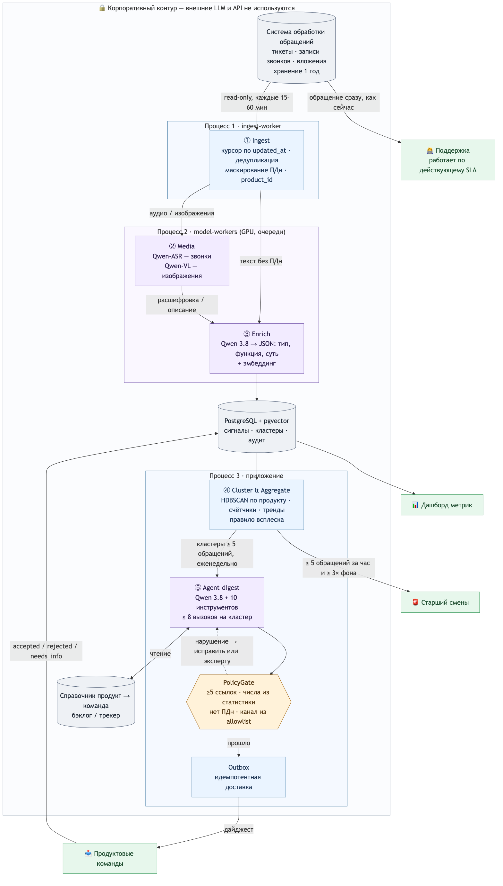

# Диаграммы решения

Исходники — Mermaid (`*.mmd`), отрисованные версии — `rendered/*.png` (для DOCX и слайдов) и `rendered/*.svg`.
Пересборка: `npx -p @mermaid-js/mermaid-cli mmdc -i 01-architecture.mmd -o rendered/01-architecture.png -s 2 -b white -c mermaid-config.json`.

| Файл | Что показывает | Где используется |
|---|---|---|
| `01-architecture` | 5 логических сервисов в 3 процессах, источники, получатели, контур без внешних API | Решение п.1, слайд «Архитектура» |
| `02-business-process` | Агент работает параллельно поддержке: всплеск → старший смены, тема → дайджест → решение команды | Решение п.1, слайд «Процесс» |
| `03-agent-workflow` | Алгоритм агента по кластеру, 4 исхода, PolicyGate, бюджет 8 вызовов | Решение п.2–3 |
| `04-digest-sequence` | Последовательность вызовов инструментов при создании элемента дайджеста | Решение п.2 |
| `05-rollout` | Офлайн-оценка → shadow → пилот → масштабирование и критерии перехода | Решение п.4 |

